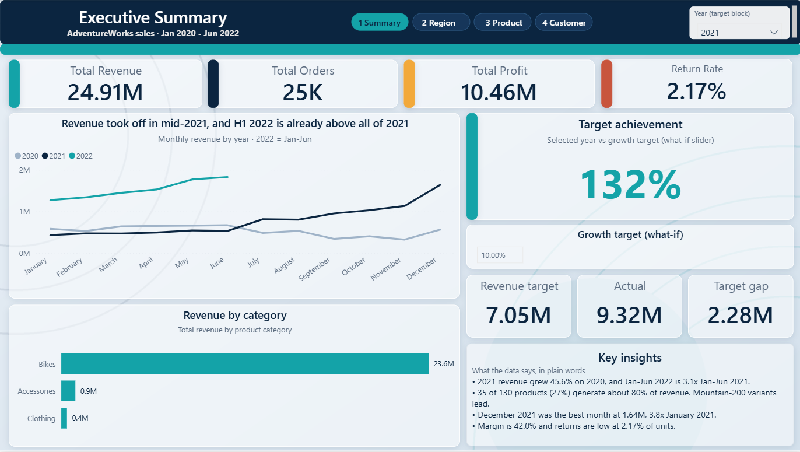
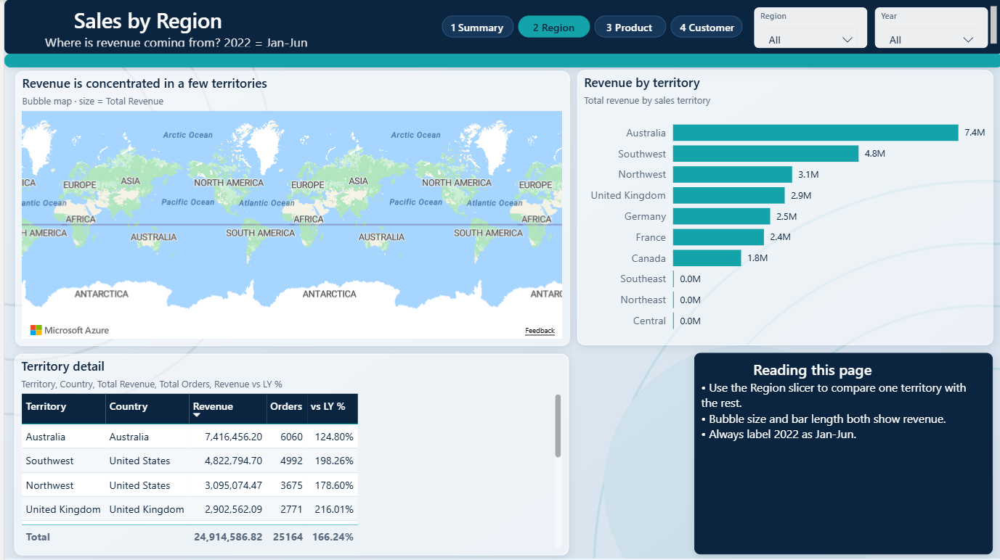
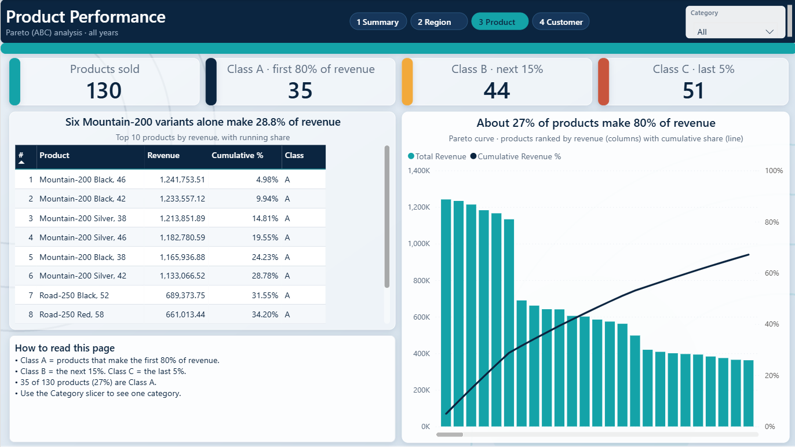
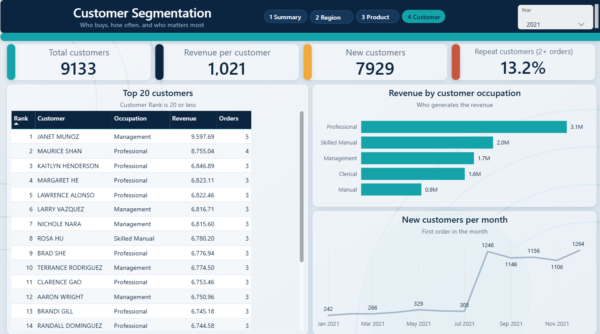

# AdventureWorks Executive Sales Dashboard (Power BI)

An interactive 4-page Power BI dashboard that analyses AdventureWorks sales from **Jan 2020 to Jun 2022**. It shows where revenue comes from, which products drive it, and who the key customers are.

## Business questions

- How is revenue, profit and margin trending over time?
- Did the business reach its growth target?
- Which regions and countries generate the most revenue?
- Which products make up most of the revenue (Pareto / ABC analysis)?
- Who are the top customers, and how many are new or repeat buyers?

## Key insights

- Total revenue of **24.91M**, total profit of **10.46M** and a **42.0% margin**
- 2021 revenue grew **45.6%** on 2020, and Jan-Jun 2022 is **3.1x** Jan-Jun 2021
- **35 of 130 products (27%)** generate about 80% of revenue, and Mountain-200 variants lead
- December 2021 was the best month at **1.64M**
- Return rate is low at **2.17%** of units
- 2021 reached **132%** of a +10% growth target (what-if parameter)

## Dashboard pages

### 1. Executive Summary
KPI cards, monthly revenue by year, revenue by category, target vs actual with an adjustable growth target, and key insights.

### 2. Sales by Region
Map of revenue by country, revenue by territory, and a territory detail table with revenue vs last year.

### 3. Product Performance
Pareto (ABC) analysis: top 10 products with cumulative share, Pareto curve, and Class A, B and C product counts.

### 4. Customer Segmentation
Top 20 customers, revenue by occupation, new customers per month, and repeat customer rate.

## Data model

Star schema with one sales fact table and four dimensions.

| Table | Type |
|---|---|
| fact_sales | Fact |
| fact_returns | Fact |
| dim_calendar | Dimension |
| dim_product | Dimension |
| dim_customer | Dimension |
| dim_territory | Dimension |

## Key DAX measures

- Total Revenue, Total Orders, Total Profit, Return Rate
- Revenue vs LY % (time intelligence)
- Product Rank, Cumulative Revenue % and Product Class (Pareto / ABC)
- Revenue Target and Target Achievement % (what-if parameter)
- Customer Rank, New Customers and Repeat Customers %

## Tools used

- Power BI Desktop
- DAX
- Power Query
- Power BI Project (PBIP) format, so the model and report are stored as readable text files

## Notes

- 2022 contains data for Jan-Jun only, so year-on-year comparisons for 2022 are partial.
- Data source: AdventureWorks sample dataset.

## Author

**Muhammad Aqib Khan**
Statistical Officer | Data Analyst (Power BI, SQL, Python)
[LinkedIn]((https://www.linkedin.com/in/aqib-khakwani-564063306/?isSelfProfile=true))
